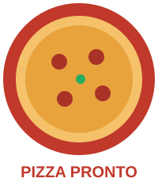

# Pizza Pronto – Our Fictional Company

> Throughout the training you are the (first ever) **security team of Pizza Pronto**.
> Whenever we discuss a topic, ask yourself: *What does this mean for Pizza Pronto?*



**Pizza Pronto** is a small pizzeria with delivery service in a mid-sized German town.
Business is good – especially Friday and Saturday evenings – and most orders now come in online.

## People

| Role | Name | IT-related notes |
|---|---|---|
| Owner | Giulia Romano | Does the accounting on the office PC, approves all payments |
| Cooks (2) | Marco, Elif | Use the kitchen tablet showing incoming orders |
| Delivery drivers (3) | Jonas, Mia, Kevin (student job) | Use their **private smartphones** for navigation and the driver app |
| Apprentice (office) | Lena | Answers emails, handles suppliers, posts on social media |
| "IT guy" | Luca – Giulia's nephew, studies computer science | Built the online shop as a side project, has admin access to everything |

## IT Landscape

```
   Customers ──► Order website (shop.pizza-pronto.example) ──► Kitchen tablet
                      │  Node.js app, hosted on a small VM
                      │  uses ~200 npm packages, some written by Luca's friend
                      ▼
               Customer database (names, addresses, phone numbers, order history)

   Office PC (Windows, shared password, on the counter)
     └─ accounting, supplier invoices, email, payroll Excel sheet

   Cash register / card terminal (provided by a payment service provider)
   Guest Wi-Fi (same router as the office PC)
   Accounts: delivery platforms, Google Business reviews, Instagram, domain registrar
   Suppliers: flour wholesaler, drinks supplier, web designer (built the website theme), payment provider
```

## Crown Jewels

- Customer data (personal data → GDPR!)
- The order website – no website on a Friday evening = no revenue
- Payment & bank access
- Social media accounts and online reviews (reputation)
- Grandma Romano's secret dough recipe 🍕

## Typical Questions During the Training

- Which assets need **confidentiality**, **integrity**, **availability**?
- Who would want to attack Pizza Pronto – and why?
- What could an attacker find out about Pizza Pronto from public sources?
- Which suppliers and software components does Pizza Pronto depend on?
- What would happen if ransomware hit the office PC on a Friday at 7 pm?
- Which simple policies would make Pizza Pronto more secure?
