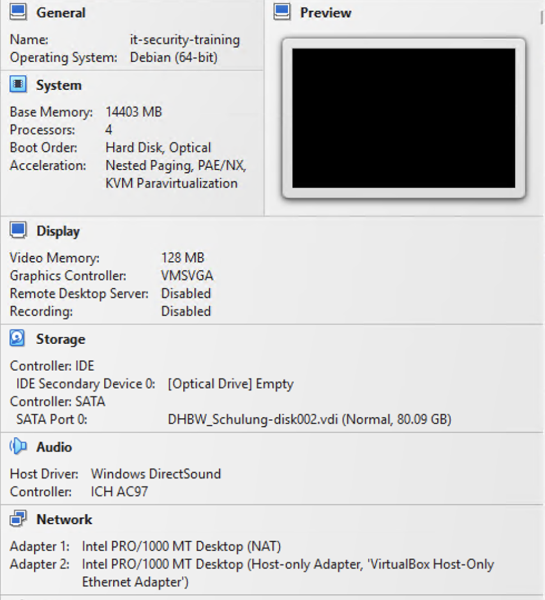
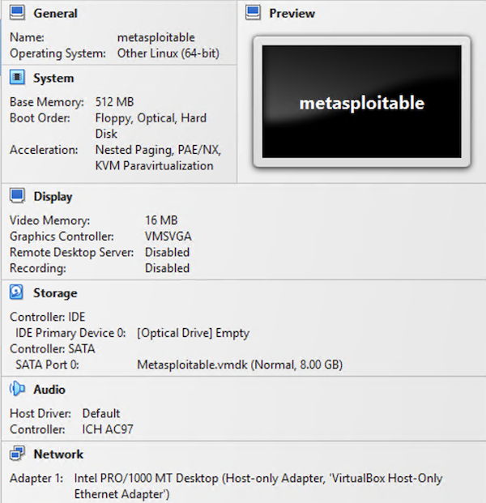

# IT Security Training

## Setup

All labs run inside a **Kali Linux** virtual machine (VirtualBox).

### 1. Machine & network

- Use one of the prepared **Windows 11** machines in the open network, **or** your own laptop.
- With your own laptop you can join the local Wi-Fi if you need it:
  - Network: **Filab**
  - Password: **Schinken123!**

### 2. Install VirtualBox

Download and install VirtualBox yourself (directly from the internet):

- Visual C++ Redistributable (needed by VirtualBox): https://aka.ms/vc14/vc_redist.x64.exe
- VirtualBox: https://www.virtualbox.org/wiki/Downloads

### 3. Get the virtual machines

The `.ova` files are on the internal share: **http://share.filab.lan**

Copy these to your machine:
- `it-security-training.ova` (Kali Linux – your working VM)
- `metasploitable.ova` (the target for the network-scanning lab)

### 4. Import into VirtualBox

1. VirtualBox → *File → Import Appliance*, select the `.ova` files.
2. Network settings:
   - **it-security-training**: Adapter 1 = NAT, Adapter 2 = Host-only Adapter
      
   - **metasploitable**: Adapter 1 = Host-only Adapter
      
3. Start both VMs and wait until they boot. You can minimise Metasploitable – you drive it from Kali.

### 5. Log in to Kali — Challenge #0 🔑

Username: `kali`

The password is **not** written down anywhere here. Finding it is your **first challenge**:
work it out **without googling**. (Hint: it is the most boring password a stock Kali
image could possibly have.)

---

## Labs

- **[Introduction to IT Security](./Introduction-to-IT-Security)** – everything for this training (OSINT, Supply Chain, DevSecOps, …)
- [API Security](./API-Security-Training)
- [Web Security](./Web-Security)
